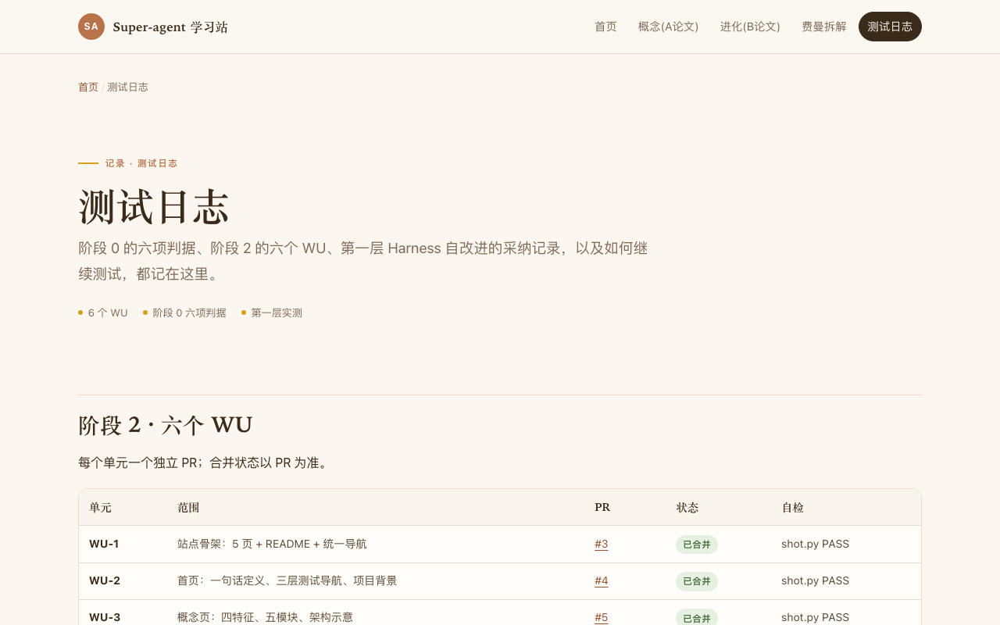

# 学习网站发布验收报告（第三层实时剧本）

> 2026-11-04 ｜ 部署：本机 dsh-superagent ｜ 任务：把学习网站整合为可发布正式版
> 结论：**建议发布**。5 个页面自检 PASS（0 blocker / 0 error / 0 warn），链接、导航、自包含均通过；本轮没有发现需要改代码的偏离。

## 验收范围与结果

| 项 | 结果 | 证据 |
| --- | --- | --- |
| 页面完整 | 5/5（index / concept / evolution / feynman / test-log） | `learning-site/.shot/report.md` |
| 无死链 | 5/5 链接检查 ok | `shot.py` 链接检查 |
| 统一 Ben 配色 | 共用 WU-1 冻结 token（`#B8734A` / `#D4A017` / `#3A2A1A` / `#FBF7F0` / `#FFFDF9` / `#E7DCCB`） | 各页内联 CSS |
| 阶段 1 数据 | 测试日志页已有「第一层 · Harness 自改进实测」 | `test-log.html` 第 171 行起 |
| 自包含 | 无外部字体/脚本/图片，`file://` 可直接打开 | `shot.py` 自包含检查 |
| 截图证据 | 1280×800，无头 Chrome | `evidence/layer3/test-log.png`、`index.png` |

## 发布建议

- **建议发布**：静态站点无构建步骤，可直接用 GitHub Pages 托管，或 `python3 -m http.server 8000 --directory learning-site` 本地验收。
- 发布前由人确认两件事：是否对外发布；是否合并汇总 PR #10（本报告与第三层就绪/机制基线在同一 PR）。
- 发布后如需补跨渠道归属，单开架构变更，不在本次发布范围内。

## 成本与干预

- 本工单 worker 累计约 25.8M / 26.1M cap（快照 2026-11-04T00:50+08:00，接近上限，本轮收口）。
- 人工干预 3 次均为决策性（15:31 需求、15:44 门禁、16:31 接受同 Thread 判据 4），纠错性 0 次。
